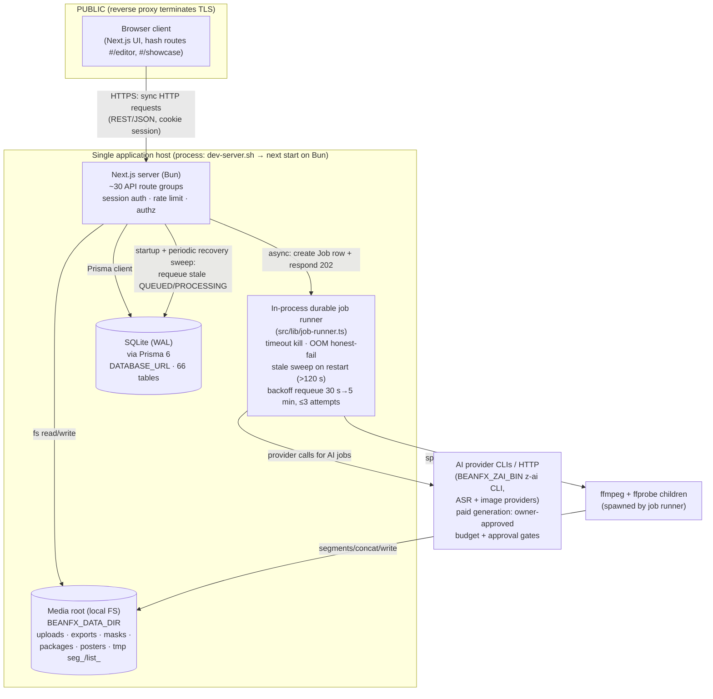

# M35 Track A — Deployment Architecture (actual, code-verified)

**Scope:** the architecture that exists in the codebase today, mapped for deployment. Components that do not exist (Python/FastAPI tier, external queue, object storage, separate worker fleet, CDN) are **not drawn**.

## 1. Component map



*(Rendered by GitHub natively; identical topology in ASCII in §6.)*

## 2. Synchronous vs asynchronous paths

| Path | Mechanism | Evidence |
|---|---|---|
| Login/register, project CRUD, timeline save, media upload+probe, mask import, package export/import, showcase intake, listings | **Synchronous HTTP** — the route handler does the work and returns the result | `src/app/api/**` route handlers |
| Timeline renders (short and long-form windowed), media re-encodes, showcase generation stages | **Asynchronous jobs** — API creates a `Job` row (`RENDER_TIMELINE`, `MEDIA_PROBE`, …), returns immediately; the in-process runner claims it, spawns ffmpeg, and the client polls `/api/jobs/:id` | `src/lib/job-runner.ts`, M20 suite flow |
| Recovery | Server-restart sweep re-queues stale jobs; backoff requeue ≤3 attempts; deterministic failures fail immediately; OOM kills fail with explanatory message (never silently retried) | `job-runner.ts:207-220`, `job-helpers.ts:155-177` |

**Communication between "workers" and the application is the database itself.** There is no queue service: the runner lives inside the Next.js process and coordinates through `Job` rows + the stale sweep. This is why Option 1 (single server) is the faithful topology today and why a future split worker must keep the DB-as-coordination contract intact (Track E) rather than introduce a second queue.

## 3. Components requiring persistent storage

| Component | Storage | Loss impact |
|---|---|---|
| SQLite DB | `DATABASE_URL` file (WAL) | users, sessions, projects, timelines, jobs, exports registry, masks metadata, provider config metadata — **critical** |
| Media root | `BEANFX_DATA_DIR` tree | original uploads, exports, masks binaries, packages, posters, generated media — **critical** |
| Nothing else | — | Next.js build output `.next/` is regenerable; ffmpeg tmp files are transient and cleaned |

## 4. Restart independence

- **Next.js server: restart-safe by design.** The stale sweep (M20 T4 SIGKILL test: kill → respawn → "Recovered after a worker interruption (attempt 1/3)" → completion) proves interrupted renders recover after restart. Safe to restart independently of anything (it is everything).
- **ffmpeg children:** never restarted independently — they are owned by the runner; an orphaned ffmpeg after a crash is harmless to correctness (its job is re-run from scratch by the sweep; windowed renders write to `seg_*` tmp files, never in place).
- **DB:** restart-safe (WAL); must not be concurrently moved/copied while writing (snapshot via `.backup`/`VACUUM INTO`).

## 5. Local-filesystem assumptions (the deployment-relevant constraints)

1. **DB and media root MUST be on the same host** in the current design — media paths are stored as filesystem paths and the runner reads them directly. A split deployment (Option 2/3) requires either a shared filesystem mount or the object-storage migration described in Track D — neither exists in code today.
2. `media-storage.ts` requires `BEANFX_DATA_DIR` to be an absolute dedicated directory (not `/`).
3. Long renders need headroom on the same volume (segments + concat output ≈ transient 2× final size; M20 T3 measured 395 s wall for a 600 s 10-window render on the 3 GB sandbox, ffmpeg RSS ~2.5 GB).
4. Default media root points at the developer's project directory (`/home/z/my-project/media-store`) — staging MUST set `BEANFX_DATA_DIR` explicitly.

## 6. ASCII topology (current reality)

```
            HTTPS (TLS terminated by reverse proxy — owner-provided)
Browser ────────────────►  Next.js server (Bun, single process)
                             │  sync: REST/JSON + cookie session (scrypt)
                             │  async: Job row → 202 → client polls /api/jobs/:id
                             ├── Prisma ───────────► SQLite file (WAL)   [persistent]
                             ├── fs I/O ───────────► media root (BEANFX_DATA_DIR) [persistent]
                             ├── spawns ───────────► ffmpeg/ffprobe children
                             │                          └── writes segments/exports → media root
                             ├── AI jobs ──────────► provider CLI/HTTP (BEANFX_ZAI_BIN, ASR, image)
                             └── restart sweep ────► requeue stale jobs (>120 s) via Job table
```

No FastAPI tier, no message queue, no object storage, no worker fleet exists in the codebase — none are drawn.
