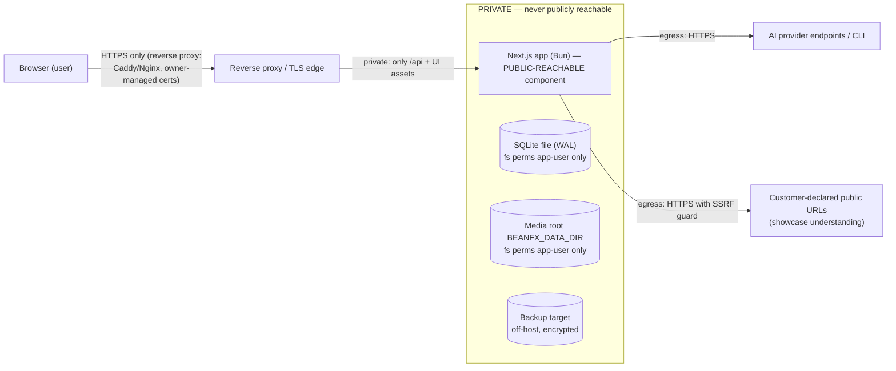

# M35 Track F — Deployment Security Architecture

**Basis:** audited code (`src/lib/auth.ts`, `rate-limit.ts`, `product-understanding.ts`, API routes, `media-storage.ts`). No secrets appear in this or any M35 document (secret check performed before publication). Consent and paid-provider gates are preserved unchanged.

## 1. Security boundary diagram

**Publicly reachable:** exactly one component — the app behind the TLS proxy (UI + `/api/*`). **Must remain private:** DB file, media root, backups, the OS itself, provider credentials (env only). In the recommended single-server topology there is no separate worker host to expose.

## 2. Audit of production-facing boundaries

| Boundary | Current state (evidence) | Deployment requirement |
|---|---|---|
| HTTPS / reverse proxy | App itself binds plain HTTP (dev-server). `PUBLIC_APP_URL` env exists. | TLS termination at proxy (Caddy auto-HTTPS or Nginx+certbot); HSTS; proxy passes only needed headers; deny direct host:port exposure via firewall. CONFIGURATION REQUIRED at staging. |
| Authentication & sessions | scrypt password hashing + `timingSafeEqual`; `beanfx_session` cookie HttpOnly/Secure/SameSite=None+**Partitioned (CHIPS)**; sessions are DB rows (stateless-friendly). | Behind TLS, `Secure` works naturally. Cookie strategy is already documented in-code (CSRF rationale). No change needed. |
| Password/identity config | scrypt (memory-hard), no plaintext storage. | Owner sets strong initial admin credentials; no default-password shipping (registration is open — decide whether staging keeps open registration or an invite policy — OWNER ACTION). |
| Project authorization | Ownership checks in API routes; sessions bound to users. | Preserved as-is; no public media paths exist (bytes served through authorized routes). |
| Guest access / collaboration | M30 invitations + review flows (token-based invitations). | Invitation tokens are capability URLs — HTTPS-only transport; expiry policy reviewed at staging (OWNER ACTION to confirm TTL policy). |
| Upload validation | Media probe (ffprobe) rejects invalid media (M34 suite: invalid media rejection VERIFIED); type/size checks at `/api/media`. | Keep probe-before-accept as the gate; no archive extraction runs on the upload path. |
| Archive extraction | M29 project-package import validates manifests (path-traversal guards in `project-archive.ts` path construction). | Re-verify import in Track J checklist (item 10). |
| SSRF controls | `product-understanding.ts`: `BLOCKED_HOSTS` regex (localhost/.local/.internal/metadata/.arpa) + DNS-resolution rejection of private/link-local IPv4+IPv6 + secret redaction before analysis. VERIFIED in code. | No change; staging must not relax these. |
| API rate limits | `src/lib/rate-limit.ts` + `RATE_LIMIT_SCALE` (test-scale env; production uses default scale 1). | Keep `RATE_LIMIT_SCALE` unset (=1) in staging/production env template. |
| Secret storage | Env vars only (`BEANFX_ZAI_BIN` path, `DATABASE_URL`, `BEANFX_DATA_DIR`, provider creds via env/official channels); no SDK keys in code (M34 secret scan clean). | `.env` files owned by app user, mode 600, **never committed**; staging template uses placeholders only (Track J). Never paste secrets in chat — owner injects them on the host. |
| Signed media URLs | Not implemented (media served via authorized API routes instead). Honest note: if public CDN delivery is ever added, presigned URLs become mandatory — designed in Track D, not built. | n/a |
| Database network access | Local file — no network listener at all. | Strongest possible posture; keep DB off any networked volume until PostgreSQL (then: private subnet, TLS, password auth — Track C plan). |
| Worker permissions | Worker = app process (same user). ffmpeg children inherit least privilege of the app user. | Run the service under a dedicated non-login system user with write access ONLY to media root + DB dir. |
| Provider credentials | Paid providers remain gated by owner-approved budget + approval fields (`generation-router.ts`, `engine.ts`); segmentation stays CONFIGURATION REQUIRED until an approved provider exists. | Unchanged — no gate weakened. No live paid call authorized in M35. |
| CORS / CSRF | Cookie is SameSite=None+Partitioned specifically to keep cross-site preview embeds working, with CSRF posture documented in-code; API is same-origin-first. | Verify at staging that cross-origin methods are not accidentally enabled (route audit in checklist). |

## 3. Secret-injection strategy (secure, no chat exposure)

1. Owner creates secrets **on the staging host** (shell or password manager), writes them to `/home/beanfx/.env.staging` (mode 600, owned by the service user).
2. The service unit loads exactly that file; env template in the repo contains **placeholders only** (`__SET_ON_HOST__`).
3. Secrets never appear in: repository, logs (provider errors are redacted by the existing redaction regexes), screenshots, test output, or documentation. The publication secret-check (§17 protocol) re-verifies this diff.
4. Rotation: re-edit the env file + service restart; no secret is baked into images or scripts.
